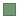

# Cobertura del arbolado urbano

Dataset que contiene las cobertura verde, o cobertura de follaje arbóreo de las áreas urbanas del Partido de Pergamino. La obtención del dato se basó en detección por IA, con correcciones manuales

| | |
|---|---|
| Identificador | `ambiente-y-agro/cobertura_arbolado_urbano` |
| Geometría | polígonos |
| Fuente | [Cobertura del arbolado urbano en GeoNode](https://geonode.pergamino.gob.ar/catalogue/#/dataset/109), capa WFS `geonode:cobertura_arbolado_urbano` |
| Licencia | [CC-BY-SA-4.0](https://creativecommons.org/licenses/by-sa/4.0/) |
| Actualización declarada por la fuente | no planificada |

## Propósito

Según el registro de GeoNode:

> El propósito del dataset de cobertura arbórea es poder contar con elementos que permitan calcular índices de ambiente que permitan mitigar el efecto de cambio climático y planificar lo urbano.

## Calidad de los datos

Según el registro de GeoNode:

> El dato fue relevado mediante el uso de imágenes aéreas de alta resolución y detección de patrones por inteligencia artificial con correcciones manuales. Debe ser usado con fines estadísticos a escalas barriales, ya que la detección automática no brinda escala de confianza para menores unidades territoriales.

## Esquema

| Columna | Tipo |
|---|---|
| `id` | int64 |
| `localidad` | string |
| `barrio` | string |
| `area` | double |
| `perimetro` | double |
| `espacio_verde` | string |
| `metodo_deteccion` | string |
| `geometry` | binary |
| `bbox` | struct<xmin: double, ymin: double, xmax: double, ymax: double> |

La fuente no publica descripciones de columnas: GeoNode devuelve una descripción vacía para cada atributo. Por eso las columnas no tienen descripción en `table:columns`, salvo `geometry` y `bbox`, que agrega este catálogo.

## Acceso

```python
import duckdb

con = duckdb.connect()
con.sql("INSTALL spatial; LOAD spatial; INSTALL httpfs; LOAD httpfs;")
con.sql("SELECT * FROM read_parquet('https://data.source.coop/nlebovits/pergamino-ide/ambiente-y-agro/cobertura_arbolado_urbano/cobertura_arbolado_urbano.parquet') LIMIT 10").show()
```

Hay más consultas, todas probadas, en [AGENTS.md](./AGENTS.md).

## Visualización

Las teselas vectoriales están en `./cobertura_arbolado_urbano.pmtiles` (capa `cobertura_arbolado_urbano`). El estilo por defecto, `styles/default.json`, deriva del estilo SLD que publica GeoNode para esta capa.

Leyenda tal como la publica la fuente:



## Versiones

Cada extracción que cambia los datos es una versión nueva. La versión actual está en `./cobertura_arbolado_urbano.parquet`. Las anteriores son los activos `version-*` de `collection.json`, con el número de registros y la suma de verificación de cada una. Sus archivos no cambian.

La primera versión proviene del GeoServer anterior de la IDE Pergamino y sigue publicada en `./publico_cobertura_arbolado_urbano.parquet`.

## Procedencia

Productor: Municipalidad de Pergamino. Publicado por la Dirección de Sistemas de Información Georreferenciada (DSIG) de la Municipalidad de Pergamino en [GeoNode](https://geonode.pergamino.gob.ar/catalogue/#/dataset/109).

Atribución declarada en GeoNode: "Municipalidad de Pergamino".

Este catálogo es un espejo. Para el dato autoritativo, consultar la IDE de Pergamino.

## Licencia

CC-BY-SA-4.0. Es la licencia que declara la Municipalidad de Pergamino para su IDE:

> Los datos dispuestos en nuestra Infraestructura de Datos Espaciales estan licenciados mediante Creative Commons 4.0 BY-SA, lo cual permite utilizar, compartir y adaptar este material siempre que reconozca atribución y permita la misma licencia en sus derivados.

## Advertencia del publicador

> La información contenida en la IDE se encuentra en constante actualización por parte de las distintas áreas responsables de su generación, por lo tanto, podria contener diferencias e inconsistencias en relación al objeto o fenómeno representado, tanto espacial como temporalmente.
