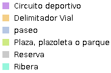

# Espacios verdes públicos

Contiene todos los espacios verdes públicos del Partido de Pergamino, como plazas, plazoletas y parques.

| | |
|---|---|
| Identificador | `ambiente-y-agro/espacios_verdes` |
| Geometría | polígonos |
| Fuente | [Espacios verdes públicos en GeoNode](https://geonode.pergamino.gob.ar/catalogue/#/dataset/148), capa WFS `geonode:espacios_verdes` |
| Licencia | [CC-BY-SA-4.0](https://creativecommons.org/licenses/by-sa/4.0/) |
| Actualización declarada por la fuente | continua |

## Propósito

Según el registro de GeoNode:

> Los espacios verdes que figuran en el dataset están categorizados de acuerdo a su situación legal: públicos o privados.

## Calidad de los datos

Según el registro de GeoNode:

> Los espacios verdes fueron relevados mediante imágenes aéreas de alta resolución. El tipo de uso, categoría y funcionalidad se determinó de acuerdo a la situación actual de cada espacio.

## Esquema

| Columna | Tipo |
|---|---|
| `id` | int64 |
| `codigo` | string |
| `poligono` | string |
| `nombre` | string |
| `titular` | string |
| `circ` | string |
| `seccion` | string |
| `chacra` | string |
| `quinta` | int64 |
| `fraccion` | int64 |
| `manzana` | string |
| `parcela` | string |
| `partida` | string |
| `localidad` | string |
| `ordenanza` | string |
| `obs` | string |
| `area` | int64 |
| `etiqueta` | string |
| `barrio` | string |
| `juegos` | string |
| `est_salud` | string |
| `monumento` | string |
| `luminaria` | string |
| `asientos` | string |
| `senda_peat` | string |
| `arbolado` | string |
| `edificado` | string |
| `mastil` | string |
| `sector` | string |
| `plan_led` | string |
| `nombre_alternativo` | string |
| `mantenimiento_electrico` | string |
| `mejoras` | string |
| `origen` | string |
| `nomenclaturas` | string |
| `alcance_uso` | string |
| `tipo_cobertura_mayoritaria` | string |
| `usos_predominantes` | string |
| `funcion` | string |
| `forma` | string |
| `denominacion` | string |
| `delimitacion` | string |
| `parcelas` | string |
| `uso_transito` | string |
| `disponibilidad` | string |
| `actualizacion` | string |
| `geometry` | binary |
| `bbox` | struct<xmin: double, ymin: double, xmax: double, ymax: double> |

La fuente no publica descripciones de columnas: GeoNode devuelve una descripción vacía para cada atributo. Por eso las columnas no tienen descripción en `table:columns`, salvo `geometry` y `bbox`, que agrega este catálogo.

## Acceso

```python
import duckdb

con = duckdb.connect()
con.sql("INSTALL spatial; LOAD spatial; INSTALL httpfs; LOAD httpfs;")
con.sql("SELECT * FROM read_parquet('https://data.source.coop/nlebovits/pergamino-ide/ambiente-y-agro/espacios_verdes/espacios_verdes.parquet') LIMIT 10").show()
```

Hay más consultas, todas probadas, en [AGENTS.md](./AGENTS.md).

## Visualización

Las teselas vectoriales están en `./espacios_verdes.pmtiles` (capa `espacios_verdes`). El estilo por defecto, `styles/default.json`, deriva del estilo SLD que publica GeoNode para esta capa.

Leyenda tal como la publica la fuente:



## Versiones

Cada extracción que cambia los datos es una versión nueva. La versión actual está en `./espacios_verdes.parquet`. Las anteriores son los activos `version-*` de `collection.json`, con el número de registros y la suma de verificación de cada una. Sus archivos no cambian.

La primera versión proviene del GeoServer anterior de la IDE Pergamino y sigue publicada en `./publico_espacios_verdes.parquet`.

## Procedencia

Productor: Municipalidad de Pergamino. Publicado por la Dirección de Sistemas de Información Georreferenciada (DSIG) de la Municipalidad de Pergamino en [GeoNode](https://geonode.pergamino.gob.ar/catalogue/#/dataset/148).

Atribución declarada en GeoNode: "Municipalidad de Pergamino".

Este catálogo es un espejo. Para el dato autoritativo, consultar la IDE de Pergamino.

## Licencia

CC-BY-SA-4.0. Es la licencia que declara la Municipalidad de Pergamino para su IDE:

> Los datos dispuestos en nuestra Infraestructura de Datos Espaciales estan licenciados mediante Creative Commons 4.0 BY-SA, lo cual permite utilizar, compartir y adaptar este material siempre que reconozca atribución y permita la misma licencia en sus derivados.

## Advertencia del publicador

> La información contenida en la IDE se encuentra en constante actualización por parte de las distintas áreas responsables de su generación, por lo tanto, podria contener diferencias e inconsistencias en relación al objeto o fenómeno representado, tanto espacial como temporalmente.
