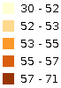

# Almacenamiento de Carbono en los suelos 2015-2022

Vectorización de los datos provisto por INTA respecto al almacenamiento de carbono en el suelo para el Partido de Pergamino con datos recolectados entre 2015 y 2022.

| | |
|---|---|
| Identificador | `ambiente-y-agro/inta_carbono_suelo_2015_2022` |
| Geometría | polígonos |
| Fuente | [Almacenamiento de Carbono en los suelos 2015-2022 en GeoNode](https://geonode.pergamino.gob.ar/catalogue/#/dataset/182), capa WFS `geonode:inta_carbono_suelo_2015_2022` |
| Licencia | [CC-BY-SA-4.0](https://creativecommons.org/licenses/by-sa/4.0/) |
| Actualización declarada por la fuente | no planificada |

## Propósito

Según el registro de GeoNode:

> En este trabajo se compiló una amplia base de sitios con datos de almacenamiento de COS colectados entre 2015-2022 y se utilizó un enfoque de mapeo digital de suelos, basado en la metodología de Random Forest, con los siguientes objetivos (i) actualizar el mapa de almacenamiento de COS (0 – 30 cm, t/ha) para el territorio de la República Argentina, (ii) estimar la incertidumbre asociada a los modelos predictivos generados y iii) obtener estadísticas de almacenamiento de COS para las ecorregiones, órdenes de suelo y áreas protegidas del país.

## Calidad de los datos

Según el registro de GeoNode:

> https://repositorio.inta.gob.ar/xmlui/handle/20.500.12123/14624

## Restricciones de uso declaradas

Según el registro de GeoNode:

> Excepto donde se diga explicitamente, este item se publica bajo la siguiente descripción: Creative Commons Attribution-NonCommercial-ShareAlike 2.5 Unported (CC BY-NC-SA 2.5)

## Esquema

| Columna | Tipo |
|---|---|
| `geometry` | binary |
| `id` | int64 |
| `fid` | int64 |
| `dn` | int64 |
| `bbox` | struct<xmin: double, ymin: double, xmax: double, ymax: double> |

La fuente no publica descripciones de columnas: GeoNode devuelve una descripción vacía para cada atributo. Por eso las columnas no tienen descripción en `table:columns`, salvo `geometry` y `bbox`, que agrega este catálogo.

## Acceso

```python
import duckdb

con = duckdb.connect()
con.sql("INSTALL spatial; LOAD spatial; INSTALL httpfs; LOAD httpfs;")
con.sql("SELECT * FROM read_parquet('https://data.source.coop/nlebovits/pergamino-ide/ambiente-y-agro/inta_carbono_suelo_2015_2022/inta_carbono_suelo_2015_2022.parquet') LIMIT 10").show()
```

Hay más consultas, todas probadas, en [AGENTS.md](./AGENTS.md).

## Visualización

Las teselas vectoriales están en `./inta_carbono_suelo_2015_2022.pmtiles` (capa `inta_carbono_suelo_2015_2022`). El estilo por defecto, `styles/default.json`, deriva del estilo SLD que publica GeoNode para esta capa.

Leyenda tal como la publica la fuente:



## Versiones

Cada extracción que cambia los datos es una versión nueva. La versión actual está en `./inta_carbono_suelo_2015_2022.parquet`. Las anteriores son los activos `version-*` de `collection.json`, con el número de registros y la suma de verificación de cada una. Sus archivos no cambian.

## Procedencia

Productor: Instituto Nacional de Tecnología Agropecuaria (INTA). Publicado por la Dirección de Sistemas de Información Georreferenciada (DSIG) de la Municipalidad de Pergamino en [GeoNode](https://geonode.pergamino.gob.ar/catalogue/#/dataset/182).

Atribución declarada en GeoNode: "Municipalidad de Pergamino, INTA".

Es un dato de otro organismo, rehospedado por el municipio. La atribución corresponde al organismo de origen.

Este catálogo es un espejo. Para el dato autoritativo, consultar la IDE de Pergamino.

## Licencia

CC-BY-SA-4.0. Es la licencia que declara la Municipalidad de Pergamino para su IDE:

> Los datos dispuestos en nuestra Infraestructura de Datos Espaciales estan licenciados mediante Creative Commons 4.0 BY-SA, lo cual permite utilizar, compartir y adaptar este material siempre que reconozca atribución y permita la misma licencia en sus derivados.

## Advertencia del publicador

> La información contenida en la IDE se encuentra en constante actualización por parte de las distintas áreas responsables de su generación, por lo tanto, podria contener diferencias e inconsistencias en relación al objeto o fenómeno representado, tanto espacial como temporalmente.
