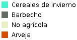

# Mapa nacional de cultivos INTA invierno 2021

Mapa nacional de cultivos INTA invierno 2021 para el Partido de Pergamino, tomado de https://geo-backend.inta.gob.ar/catalogue/#/dataset/490

| | |
|---|---|
| Identificador | `ambiente-y-agro/inta_mnc_2021_invierno` |
| Geometría | polígonos |
| Fuente | [Mapa nacional de cultivos INTA invierno 2021 en GeoNode](https://geonode.pergamino.gob.ar/catalogue/#/dataset/187), capa WFS `geonode:inta_mnc_2021_invierno` |
| Licencia | [CC-BY-SA-4.0](https://creativecommons.org/licenses/by-sa/4.0/) |
| Actualización declarada por la fuente | no planificada |

## Propósito

Según el registro de GeoNode:

> El objetivo de esta capa es publicar para todo el Partido de Pergamino cómo se distribuyen territorialmente los cultivos en cada campaña.

## Calidad de los datos

Según el registro de GeoNode:

> El dataset fue elaborado y publicado por GeoINTA en formato raster. Desde la IDE Pergamino se vectorizó y republicó con los datos correspondientes.

## Esquema

| Columna | Tipo |
|---|---|
| `geometry` | binary |
| `id` | int64 |
| `dn` | int64 |
| `categoria` | string |
| `bbox` | struct<xmin: double, ymin: double, xmax: double, ymax: double> |

La fuente no publica descripciones de columnas: GeoNode devuelve una descripción vacía para cada atributo. Por eso las columnas no tienen descripción en `table:columns`, salvo `geometry` y `bbox`, que agrega este catálogo.

## Acceso

```python
import duckdb

con = duckdb.connect()
con.sql("INSTALL spatial; LOAD spatial; INSTALL httpfs; LOAD httpfs;")
con.sql("SELECT * FROM read_parquet('https://data.source.coop/nlebovits/pergamino-ide/ambiente-y-agro/inta_mnc_2021_invierno/inta_mnc_2021_invierno.parquet') LIMIT 10").show()
```

Hay más consultas, todas probadas, en [AGENTS.md](./AGENTS.md).

## Visualización

Las teselas vectoriales están en `./inta_mnc_2021_invierno.pmtiles` (capa `inta_mnc_2021_invierno`). El estilo por defecto, `styles/default.json`, deriva del estilo SLD que publica GeoNode para esta capa.

Leyenda tal como la publica la fuente:



## Versiones

Cada extracción que cambia los datos es una versión nueva. La versión actual está en `./inta_mnc_2021_invierno.parquet`. Las anteriores son los activos `version-*` de `collection.json`, con el número de registros y la suma de verificación de cada una. Sus archivos no cambian.

La primera versión proviene del GeoServer anterior de la IDE Pergamino y sigue publicada en `./publico_inta_mnc_2021_invierno.parquet`.

## Procedencia

Productor: Instituto Nacional de Tecnología Agropecuaria (INTA). Publicado por la Dirección de Sistemas de Información Georreferenciada (DSIG) de la Municipalidad de Pergamino en [GeoNode](https://geonode.pergamino.gob.ar/catalogue/#/dataset/187).

Atribución declarada en GeoNode: "Municipalidad de Pergamino, INTA".

Es un dato de otro organismo, rehospedado por el municipio. La atribución corresponde al organismo de origen.

Este catálogo es un espejo. Para el dato autoritativo, consultar la IDE de Pergamino.

## Licencia

CC-BY-SA-4.0. Es la licencia que declara la Municipalidad de Pergamino para su IDE:

> Los datos dispuestos en nuestra Infraestructura de Datos Espaciales estan licenciados mediante Creative Commons 4.0 BY-SA, lo cual permite utilizar, compartir y adaptar este material siempre que reconozca atribución y permita la misma licencia en sus derivados.

## Advertencia del publicador

> La información contenida en la IDE se encuentra en constante actualización por parte de las distintas áreas responsables de su generación, por lo tanto, podria contener diferencias e inconsistencias en relación al objeto o fenómeno representado, tanto espacial como temporalmente.
