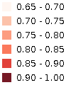

# Edificaciones detectadas con IA

Edificaciones detectadas automáticamente para el Partido de Pergamino por google research mediante entrenamiento IA: Open Buildings 2023. Cada edificio posee un coeficiente de certeza, mientras más cercano a 1 se encuentre, mayor será su probabilidad de que efectivamente se trate de una edificación.

| | |
|---|---|
| Identificador | `catastro/edificaciones_automaticas` |
| Geometría | polígonos |
| Fuente | [Edificaciones detectadas con IA en GeoNode](https://geonode.pergamino.gob.ar/catalogue/#/dataset/140), capa WFS `geonode:edificaciones_automaticas` |
| Licencia | [CC-BY-SA-4.0](https://creativecommons.org/licenses/by-sa/4.0/) |
| Actualización declarada por la fuente | no planificada |

## Propósito

Según el registro de GeoNode:

> Un conjunto de datos de la huella de construcción para apoyar las buenas aplicaciones sociales. El dato es referencial.

## Calidad de los datos

Según el registro de GeoNode:

> Para cada edificio en este conjunto de datos incluimos el polígono describiendo su huella en el suelo, una puntuación de confianza que indica lo seguros que estamos de que este es un edificio, y un Código Plus correspondiente al centro del edificio. No hay información sobre el tipo de edificio, su dirección de la calle, o cualquier detalle que no sea su geometría. https://sites.research.google/gr/open-buildings/

## Esquema

| Columna | Tipo |
|---|---|
| `id` | int64 |
| `latitude` | double |
| `longitude` | double |
| `area_in_meters` | double |
| `confidence` | double |
| `full_plus_code` | string |
| `nombre` | string |
| `tipo` | string |
| `localidad` | string |
| `nomencla` | string |
| `partida` | double |
| `etiqueta` | string |
| `circunscripcion` | int64 |
| `seccion` | string |
| `chacra_numero` | int64 |
| `chacra_letra` | string |
| `quinta_numero` | int64 |
| `quinta_letra` | string |
| `fraccion_numero` | int64 |
| `fraccion_letra` | string |
| `manzana_numero` | int64 |
| `manzana_letra` | string |
| `parcela_numero` | int64 |
| `parcela_letra` | string |
| `tipo_objeto_siser` | int64 |
| `numero_objeto_siser` | decimal128(38, 0) |
| `subpar_uf` | int64 |
| `zonificacion` | string |
| `matricula` | string |
| `n` | int64 |
| `distance` | double |
| `altura_minima` | int64 |
| `altura_promedio` | int64 |
| `altura_maxima` | int64 |
| `geometry` | binary |
| `bbox` | struct<xmin: double, ymin: double, xmax: double, ymax: double> |

La fuente no publica descripciones de columnas: GeoNode devuelve una descripción vacía para cada atributo. Por eso las columnas no tienen descripción en `table:columns`, salvo `geometry` y `bbox`, que agrega este catálogo.

## Acceso

```python
import duckdb

con = duckdb.connect()
con.sql("INSTALL spatial; LOAD spatial; INSTALL httpfs; LOAD httpfs;")
con.sql("SELECT * FROM read_parquet('https://data.source.coop/nlebovits/pergamino-ide/catastro/edificaciones_automaticas/edificaciones_automaticas.parquet') LIMIT 10").show()
```

Hay más consultas, todas probadas, en [AGENTS.md](./AGENTS.md).

## Visualización

Las teselas vectoriales están en `./edificaciones_automaticas.pmtiles` (capa `edificaciones_automaticas`). El estilo por defecto, `styles/default.json`, deriva del estilo SLD que publica GeoNode para esta capa.

Las teselas llevan solo los atributos que usan los mapas: `altura_minima`, `altura_promedio`, `altura_maxima`, `nombre`, `localidad`, `confidence`. Las demás columnas están en el GeoParquet.

Leyenda tal como la publica la fuente:



## Versiones

Cada extracción que cambia los datos es una versión nueva. La versión actual está en `./edificaciones_automaticas.parquet`. Las anteriores son los activos `version-*` de `collection.json`, con el número de registros y la suma de verificación de cada una. Sus archivos no cambian.

## Procedencia

Productor: Municipalidad de Pergamino. Publicado por la Dirección de Sistemas de Información Georreferenciada (DSIG) de la Municipalidad de Pergamino en [GeoNode](https://geonode.pergamino.gob.ar/catalogue/#/dataset/140).

Atribución declarada en GeoNode: "Municipalidad de Pergamino, Google Research".

Este catálogo es un espejo. Para el dato autoritativo, consultar la IDE de Pergamino.

## Licencia

CC-BY-SA-4.0. Es la licencia que declara la Municipalidad de Pergamino para su IDE:

> Los datos dispuestos en nuestra Infraestructura de Datos Espaciales estan licenciados mediante Creative Commons 4.0 BY-SA, lo cual permite utilizar, compartir y adaptar este material siempre que reconozca atribución y permita la misma licencia en sus derivados.

## Advertencia del publicador

> La información contenida en la IDE se encuentra en constante actualización por parte de las distintas áreas responsables de su generación, por lo tanto, podria contener diferencias e inconsistencias en relación al objeto o fenómeno representado, tanto espacial como temporalmente.
