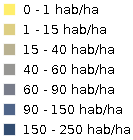

# Densidad de población por Mapeo Dasimétrico - Censo 2022

Este conjunto de datos georreferenciados presenta la estimación espacial desagregada de la población, los hogares y diversos indicadores de vulnerabilidad sociohabitacional a escala de manzana urbana para el Partido de Pergamino (ISDD). El dataset ha sido generado utilizando como fuente primaria los microdatos del Censo Nacional de Población, Hogares y Viviendas 2022 a nivel de radio censal, y como fuentes auxiliares el dataset de OpenBuildingMap (OBM) y el catastro local.

| | |
|---|---|
| Identificador | `demografia/manzanas_isdd` |
| Geometría | polígonos |
| Fuente | [Densidad de población por Mapeo Dasimétrico - Censo 2022 en GeoNode](https://geonode.pergamino.gob.ar/catalogue/#/dataset/440), capa WFS `geonode:manzanas_isdd` |
| Licencia | [CC-BY-SA-4.0](https://creativecommons.org/licenses/by-sa/4.0/) |
| Actualización declarada por la fuente | no planificada |

## Propósito

Según el registro de GeoNode:

> Esta capa de información geoespacial de alta resolución está diseñada para servir como un insumo estratégico y sistema de soporte para la toma de decisiones públicas. El propósito es poder contar con el dato de estadísticas de población y hogares a nivel de manzana.

## Calidad de los datos

Según el registro de GeoNode:

> La capa fue elaborada a partir de la metodología del mapeo por distribución dasimétrica, donde se utilizaron datos a nivel de radio censal 2022 publicados por INDEC, Poblaciones, Catastro Pergamino y OpenBuildingMap (OBM), respetando la premisa del secreto estadístico a este nivel, puesto que estos datos son estimaciones sobre el dato a nivel de radio.

## Información complementaria

Según el registro de GeoNode:

> Descriptores de los Índices sintéticos de Distribución Dasimétrica: poblacion_isdd: Cantidad estimada de población calculada por distribución dasimétrica, sobre la que se basan los índices sintéticos. hogares_isdd: Cantidad estimada de hogares calculada por distribución dasimétrica, sobre la que se basan los índices sintéticos. h_nbi_si: Cantidad estimada de hogares que presentan al menos una Necesidad Básica Insatisfecha (NBI) por manzana. p_nbi_si: Cantidad estimada de población residente en hogares con al menos una Necesidad Básica Insatisfecha (NBI) por manzana. h_hacina_crit: Cantidad estimada de hogares en condiciones de hacinamiento crítico por manzana. p_hacina_crit: Cantidad estimada de población en situación de hacinamiento crítico por manzana. h_inmat_def: Cantidad estimada de hogares en viviendas construidas con materiales poco resistentes o de baja calidad por manzana. p_inmat_def: Cantidad estimada de población habitante en viviendas con materiales poco resistentes o de baja calidad por manzana. h_nbi_h15_h17_h18: Cantidad estimada de hogares en viviendas con servicios sanitarios deficientes (falta de acceso a la red de cloacas) por manzana. p_nbi_h15_h17_h18: Cantidad estimada de población en hogares con servicios sanitarios deficientes (falta de acceso a la red de cloacas) por manzana. p_sin_cob: Cantidad estimada de población que no cuenta con cobertura de salud (obra social, prepaga o plan estatal) por manzana. p_edad_0_14: Cantidad estimada de población infantil y adolescente (de 0 a 14 años) por manzana. p_edad_65_mas: Cantidad estimada de población de adultos mayores (de 65 años o más) por manzana. h_viv_def: Cantidad estimada de hogares residiendo en viviendas deficitarias por manzana. p_viv_def: Cantidad estimada de población en viviendas deficitarias por manzana. h_agua_sin_red: Cantidad estimada de hogares sin acceso a la red pública de agua corriente por manzana. p_agua_sin_red: Cantidad estimada de población sin acceso a la red pública de agua corriente por manzana. densidad_isdd_hab_ha: Densidad de población estimada por hectárea (hab/ha) a nivel de manzana mediante el modelo dasimétrico ISDD.

## Esquema

| Columna | Tipo |
|---|---|
| `fid` | int64 |
| `codigo` | double |
| `viviendas_2020` | int64 |
| `domicilios_2020` | int64 |
| `clasificacion` | string |
| `seccion` | int64 |
| `barrio` | string |
| `barrio_tipo` | string |
| `poblacion_radio` | int64 |
| `hogares_radio` | int64 |
| `area_m2` | double |
| `poblacion_isdd` | double |
| `hogares_isdd` | double |
| `redcode` | double |
| `poblacion_isdd_radio` | double |
| `hogares_isdd_radio` | double |
| `coeficiente_mz_radio_isdd` | double |
| `h_nbi_si` | double |
| `p_nbi_si` | double |
| `h_hacina_crit` | double |
| `p_hacina_crit` | double |
| `h_inmat_def` | double |
| `p_inmat_def` | double |
| `h_nbi_h15_h17_h18` | double |
| `p_nbi_h15_h17_h18` | double |
| `p_sin_cob` | double |
| `p_edad_0_14` | double |
| `p_edad_65_mas` | double |
| `h_viv_def` | double |
| `p_viv_def` | double |
| `h_agua_sin_red` | double |
| `p_agua_sin_red` | double |
| `densidad_isdd_hab_ha` | double |
| `geometry` | binary |
| `bbox` | struct<xmin: double, ymin: double, xmax: double, ymax: double> |

La fuente no publica descripciones de columnas: GeoNode devuelve una descripción vacía para cada atributo. Por eso las columnas no tienen descripción en `table:columns`, salvo `geometry` y `bbox`, que agrega este catálogo.

## Acceso

```python
import duckdb

con = duckdb.connect()
con.sql("INSTALL spatial; LOAD spatial; INSTALL httpfs; LOAD httpfs;")
con.sql("SELECT * FROM read_parquet('https://data.source.coop/nlebovits/pergamino-ide/demografia/manzanas_isdd/manzanas_isdd.parquet') LIMIT 10").show()
```

Hay más consultas, todas probadas, en [AGENTS.md](./AGENTS.md).

## Visualización

Las teselas vectoriales están en `./manzanas_isdd.pmtiles` (capa `manzanas_isdd`). El estilo por defecto, `styles/default.json`, deriva del estilo SLD que publica GeoNode para esta capa.

Leyenda tal como la publica la fuente:



## Versiones

Cada extracción que cambia los datos es una versión nueva. La versión actual está en `./manzanas_isdd.parquet`. Las anteriores son los activos `version-*` de `collection.json`, con el número de registros y la suma de verificación de cada una. Sus archivos no cambian.

## Procedencia

Productor: Instituto Nacional de Estadística y Censos (INDEC). Publicado por la Dirección de Sistemas de Información Georreferenciada (DSIG) de la Municipalidad de Pergamino en [GeoNode](https://geonode.pergamino.gob.ar/catalogue/#/dataset/440).

Atribución declarada en GeoNode: "Municipalidad de Pergamino, INDEC, Poblaciones, OpenBuildingMap".

Es un dato de otro organismo, rehospedado por el municipio. La atribución corresponde al organismo de origen.

Este catálogo es un espejo. Para el dato autoritativo, consultar la IDE de Pergamino.

## Licencia

CC-BY-SA-4.0. Es la licencia que declara la Municipalidad de Pergamino para su IDE:

> Los datos dispuestos en nuestra Infraestructura de Datos Espaciales estan licenciados mediante Creative Commons 4.0 BY-SA, lo cual permite utilizar, compartir y adaptar este material siempre que reconozca atribución y permita la misma licencia en sus derivados.

## Advertencia del publicador

> La información contenida en la IDE se encuentra en constante actualización por parte de las distintas áreas responsables de su generación, por lo tanto, podria contener diferencias e inconsistencias en relación al objeto o fenómeno representado, tanto espacial como temporalmente.
