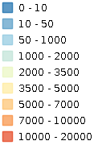

# Densidad de población 2022

Datos georreferenciados del Censo 2022 donde se puede observar la densidad poblacional por radio censal.

| | |
|---|---|
| Identificador | `demografia/poblacion_2022` |
| Geometría | polígonos |
| Fuente | [Densidad de población 2022 en GeoNode](https://geonode.pergamino.gob.ar/catalogue/#/dataset/434), capa WFS `geonode:2022_poblacion` |
| Licencia | [CC-BY-SA-4.0](https://creativecommons.org/licenses/by-sa/4.0/) |
| Actualización declarada por la fuente | no planificada |

## Propósito

Según el registro de GeoNode:

> - Hacer accesible información pública para mejorar compresión de las temáticas sociales en la Argentina.- Fomentar la ciencia abierta, proveyendo una plataforma donde volcar la producción cartográfica de los diversos grupos de investigadores que trabajan en el país en temáticas sociales georreferenciales.- Facilitar la colaboración entre investigadores, dando mayor visibilidad a la producción existente y fomentando la reutilización de fuentes primarias ya disponibles.- Mediar entre las prácticas y productos de los organismos estatales de producción de información estadística y cartográfica y los usuarios de dicha información, generando conocimiento acerca de los requerimientos, demandas y dificultades que estos últimos manifiesten a partir de su interacción con la información disponible.- Constituir una fuente confiable y documentada de información social, dando un tratamiento apropiado a las referencias institucionales, de autoría, metodología y licencias de uso de cada obra puesta a disposición.- Permitir a investigadores y agentes de gobierno (nacional, provincial, municipal) acceder de manera segmentada y ágil a información crítica para la toma de decisiones en política pública y aspectos relevante de la administración.

## Calidad de los datos

Según el registro de GeoNode:

> Gonzalo Rodríguez y Pablo De Grande (2024). Cartografía de radios del Censo Nacional de Población y Viviendas 2022. Recuperado el 4 de agosto, 2026, de https://mapa.poblaciones.org/.Poblaciones es una plataforma abierta de datos espaciales de la Argentina desarrollada por el Observatorio de la Deuda Social Argentina (ODSA) de la Universidad Católica Argentina (UCA) y el Consejo Nacional de Investigaciones Científicas y Técnicas (CONICET). Este desarrollo se lleva a cabo a través de la labor creativa de los equipos de investigación de ambas instituciones y de la colaboración de investigadores externos.

## Información complementaria

Según el registro de GeoNode:

> Para ver la descripciones de los atributos dirigirse al siguiente archivo: https://geonode.pergamino.gob.ar/catalogue/#/document/437

## Esquema

| Columna | Tipo |
|---|---|
| `geometry` | binary |
| `id` | int64 |
| `fid` | int64 |
| `redcode` | double |
| `p_total` | int64 |
| `p_a17` | int64 |
| `p_0a3` | int64 |
| `p_4a5` | int64 |
| `p_6a12` | int64 |
| `p_13a17` | int64 |
| `p_18a` | int64 |
| `p_18a29` | int64 |
| `p_30a54` | int64 |
| `p_55a69` | int64 |
| `p_70a` | int64 |
| `m_total` | int64 |
| `m_a17` | int64 |
| `m_0a3` | int64 |
| `m_4a5` | int64 |
| `m_6a12` | int64 |
| `m_13a17` | int64 |
| `m_18a` | int64 |
| `m_18a29` | int64 |
| `m_30a54` | int64 |
| `m_55a69` | int64 |
| `m_70a` | int64 |
| `v_total` | int64 |
| `v_a17` | int64 |
| `v_0a3` | int64 |
| `v_4a5` | int64 |
| `v_6a12` | int64 |
| `v_13a17` | int64 |
| `v_18a` | int64 |
| `v_18a29` | int64 |
| `v_30a54` | int64 |
| `v_55a69` | int64 |
| `v_70a` | int64 |
| `p0a3_asiste` | int64 |
| `p_cobertura_123` | int64 |
| `p_cobertura_4` | int64 |
| `p_cobertura_5` | int64 |
| `p65_jubilacion` | int64 |
| `p65_pension` | int64 |
| `p65_jubilacion_o_pension` | int64 |
| `p_pension_no_contrib` | int64 |
| `p65_total` | int64 |
| `p18a_sin_instruccion` | int64 |
| `p18a_primaria` | int64 |
| `p18a_secundaria` | int64 |
| `p18a_soloprimaria` | int64 |
| `p18a_solosecundaria` | int64 |
| `p18a_terciaria` | int64 |
| `p18a_universitaria` | int64 |
| `p4a5_asiste` | int64 |
| `p6a12_asiste` | int64 |
| `p1317_asiste` | int64 |
| `p1317_sin_secundaria` | int64 |
| `p1829_asiste` | int64 |
| `p1829_sin_secundaria` | int64 |
| `p1425_asiste` | int64 |
| `p1425_sin_secundaria` | int64 |
| `p1425` | int64 |
| `codprov` | double |
| `prov` | string |
| `coddpto` | double |
| `dpto` | string |
| `redcode_1` | double |
| `radio` | string |
| `radios_poblacion_total` | int64 |
| `radios_hogares_total` | int64 |
| `radios_latitud_centroide` | double |
| `radios_longitud_centroide` | double |
| `radios_superficie_km2` | double |
| `densidad_hab_km2` | double |
| `bbox` | struct<xmin: double, ymin: double, xmax: double, ymax: double> |

La fuente no publica descripciones de columnas: GeoNode devuelve una descripción vacía para cada atributo. Por eso las columnas no tienen descripción en `table:columns`, salvo `geometry` y `bbox`, que agrega este catálogo.

## Acceso

```python
import duckdb

con = duckdb.connect()
con.sql("INSTALL spatial; LOAD spatial; INSTALL httpfs; LOAD httpfs;")
con.sql("SELECT * FROM read_parquet('https://data.source.coop/nlebovits/pergamino-ide/demografia/poblacion_2022/poblacion_2022.parquet') LIMIT 10").show()
```

Hay más consultas, todas probadas, en [AGENTS.md](./AGENTS.md).

## Visualización

Las teselas vectoriales están en `./poblacion_2022.pmtiles` (capa `poblacion_2022`). El estilo por defecto, `styles/default.json`, deriva del estilo SLD que publica GeoNode para esta capa.

Leyenda tal como la publica la fuente:



## Versiones

Cada extracción que cambia los datos es una versión nueva. La versión actual está en `./poblacion_2022.parquet`. Las anteriores son los activos `version-*` de `collection.json`, con el número de registros y la suma de verificación de cada una. Sus archivos no cambian.

## Procedencia

Productor: Municipalidad de Pergamino. Publicado por la Dirección de Sistemas de Información Georreferenciada (DSIG) de la Municipalidad de Pergamino en [GeoNode](https://geonode.pergamino.gob.ar/catalogue/#/dataset/434).

Atribución declarada en GeoNode: "Municipalidad de Pergamino, Poblaciones".

Este catálogo es un espejo. Para el dato autoritativo, consultar la IDE de Pergamino.

## Licencia

CC-BY-SA-4.0. Es la licencia que declara la Municipalidad de Pergamino para su IDE:

> Los datos dispuestos en nuestra Infraestructura de Datos Espaciales estan licenciados mediante Creative Commons 4.0 BY-SA, lo cual permite utilizar, compartir y adaptar este material siempre que reconozca atribución y permita la misma licencia en sus derivados.

## Advertencia del publicador

> La información contenida en la IDE se encuentra en constante actualización por parte de las distintas áreas responsables de su generación, por lo tanto, podria contener diferencias e inconsistencias en relación al objeto o fenómeno representado, tanto espacial como temporalmente.
