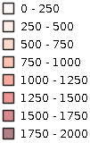

# REDATAM Censo 2022 por radio

La capa contiene múltiples datos de población obtenidos en el Censo del 2022 a nivel de radio censal para el Partido de Pergamino, como cantidad de habitantes, mujeres, varones, rangos etáreos, etc.

| | |
|---|---|
| Identificador | `demografia/redatam_censo_2022_radios` |
| Geometría | polígonos |
| Fuente | [REDATAM Censo 2022 por radio en GeoNode](https://geonode.pergamino.gob.ar/catalogue/#/dataset/248), capa WFS `geonode:redatam_censo_2022_radios` |
| Licencia | [CC-BY-SA-4.0](https://creativecommons.org/licenses/by-sa/4.0/) |
| Actualización declarada por la fuente | no planificada |

## Propósito

Según el registro de GeoNode:

> El propósito de esta capa es brindar acceso a los últimos datos de población censados por el INDEC en el año 2022, para su uso en todo tipo de estudios o análisis geoestadísticos.

## Calidad de los datos

Según el registro de GeoNode:

> Datos de población del Censo INDEC 2022 obtenido de REDATAM y geometría del Departamento de DPE PBA.

## Esquema

| Columna | Tipo |
|---|---|
| `id` | int64 |
| `fid` | int64 |
| `clavera` | double |
| `codigo_partido` | int64 |
| `codigo_localidad` | double |
| `nombre_localidad` | string |
| `fraccion` | double |
| `radio` | double |
| `tipo` | string |
| `radio_id` | double |
| `mujeres_total` | int64 |
| `varones_total` | int64 |
| `poblacion_total` | int64 |
| `indice_normalizado_sexo` | double |
| `mujeres_porcentaje` | double |
| `varones_porcentaje` | double |
| `poblacion_porcentaje_sobre_total` | double |
| `edad_hasta_14` | int64 |
| `edad_entre_14_y_64` | int64 |
| `edad_64_o_mas` | int64 |
| `edad_hasta_14_porcentaje` | double |
| `edad_entre_14_y_64_porcentaje` | double |
| `edad_64_o_mas_porcentaje` | double |
| `viviendas` | int64 |
| `hogares` | int64 |
| `indice_normalizado_vivienda_hogar` | double |
| `viviendas_ocupadas` | int64 |
| `viviendas_desocupadas` | int64 |
| `indice_normalizado_ocupacion_vivienda` | double |
| `densidad` | double |
| `geometry` | binary |
| `bbox` | struct<xmin: double, ymin: double, xmax: double, ymax: double> |

La fuente no publica descripciones de columnas: GeoNode devuelve una descripción vacía para cada atributo. Por eso las columnas no tienen descripción en `table:columns`, salvo `geometry` y `bbox`, que agrega este catálogo.

## Acceso

```python
import duckdb

con = duckdb.connect()
con.sql("INSTALL spatial; LOAD spatial; INSTALL httpfs; LOAD httpfs;")
con.sql("SELECT * FROM read_parquet('https://data.source.coop/nlebovits/pergamino-ide/demografia/redatam_censo_2022_radios/redatam_censo_2022_radios.parquet') LIMIT 10").show()
```

Hay más consultas, todas probadas, en [AGENTS.md](./AGENTS.md).

## Visualización

Las teselas vectoriales están en `./redatam_censo_2022_radios.pmtiles` (capa `redatam_censo_2022_radios`). El estilo por defecto, `styles/default.json`, deriva del estilo SLD que publica GeoNode para esta capa.

Leyenda tal como la publica la fuente:



## Versiones

Cada extracción que cambia los datos es una versión nueva. La versión actual está en `./redatam_censo_2022_radios.parquet`. Las anteriores son los activos `version-*` de `collection.json`, con el número de registros y la suma de verificación de cada una. Sus archivos no cambian.

La primera versión proviene del GeoServer anterior de la IDE Pergamino y sigue publicada en `./publico_redatam_censo_2022_radios.parquet`.

## Procedencia

Productor: Municipalidad de Pergamino. Publicado por la Dirección de Sistemas de Información Georreferenciada (DSIG) de la Municipalidad de Pergamino en [GeoNode](https://geonode.pergamino.gob.ar/catalogue/#/dataset/248).

Atribución declarada en GeoNode: "Municipalidad de Pergamino".

Este catálogo es un espejo. Para el dato autoritativo, consultar la IDE de Pergamino.

## Licencia

CC-BY-SA-4.0. Es la licencia que declara la Municipalidad de Pergamino para su IDE:

> Los datos dispuestos en nuestra Infraestructura de Datos Espaciales estan licenciados mediante Creative Commons 4.0 BY-SA, lo cual permite utilizar, compartir y adaptar este material siempre que reconozca atribución y permita la misma licencia en sus derivados.

## Advertencia del publicador

> La información contenida en la IDE se encuentra en constante actualización por parte de las distintas áreas responsables de su generación, por lo tanto, podria contener diferencias e inconsistencias en relación al objeto o fenómeno representado, tanto espacial como temporalmente.
