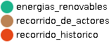

# Circuitos energéticos (TEAM-UNNOBA)

Circuitos energéticos identificados por el equipo de investigación TEAM UNNOBA para todo el Partido de Pergamino.

| | |
|---|---|
| Identificador | `energia-y-conectividad/circuitos_energeticos` |
| Geometría | puntos |
| Fuente | [Circuitos energéticos (TEAM-UNNOBA) en GeoNode](https://geonode.pergamino.gob.ar/catalogue/#/dataset/306), capa WFS `geonode:circuitos_energeticos` |
| Licencia | [CC-BY-SA-4.0](https://creativecommons.org/licenses/by-sa/4.0/) |
| Actualización declarada por la fuente | desconocida |

## Propósito

Según el registro de GeoNode:

> Los circuitos energéticos de escala local buscan dar a conocer y poner en valor iniciativas, proyectos y patrimonio vinculado a la energía en diversas localidades del país. La construcción gráfica de los circuitos busca se reconozca y aprecie el valor de los recursos energéticos y alentar prácticas sostenibles, potenciando capacidades locales y de articulación en red.

## Calidad de los datos

Según el registro de GeoNode:

> El trabajo fue realizado en conjunto por el Centro de Estudios sobre Territorio, Energía yAmbiente de la Universidad Nacional del Noroeste de la Provincia de Buenos Aires (TEAM-UNNOBA) y la Dirección de Gestión Ambiental de la Municipalidad de Pergamino.

## Esquema

| Columna | Tipo |
|---|---|
| `geometry` | binary |
| `id` | int64 |
| `denominacion` | string |
| `identificador` | string |
| `sendero` | string |
| `ubicacion` | string |
| `promotor` | string |
| `año` | string |
| `financiamiento` | string |
| `tecnologia` | string |
| `fuente` | string |
| `enlace_team` | string |
| `proposito` | string |
| `bbox` | struct<xmin: double, ymin: double, xmax: double, ymax: double> |

La fuente no publica descripciones de columnas: GeoNode devuelve una descripción vacía para cada atributo. Por eso las columnas no tienen descripción en `table:columns`, salvo `geometry` y `bbox`, que agrega este catálogo.

## Acceso

```python
import duckdb

con = duckdb.connect()
con.sql("INSTALL spatial; LOAD spatial; INSTALL httpfs; LOAD httpfs;")
con.sql("SELECT * FROM read_parquet('https://data.source.coop/nlebovits/pergamino-ide/energia-y-conectividad/circuitos_energeticos/circuitos_energeticos.parquet') LIMIT 10").show()
```

Hay más consultas, todas probadas, en [AGENTS.md](./AGENTS.md).

## Visualización

Las teselas vectoriales están en `./circuitos_energeticos.pmtiles` (capa `circuitos_energeticos`). El estilo por defecto, `styles/default.json`, deriva del estilo SLD que publica GeoNode para esta capa.

Leyenda tal como la publica la fuente:



## Versiones

Cada extracción que cambia los datos es una versión nueva. La versión actual está en `./circuitos_energeticos.parquet`. Las anteriores son los activos `version-*` de `collection.json`, con el número de registros y la suma de verificación de cada una. Sus archivos no cambian.

La primera versión proviene del GeoServer anterior de la IDE Pergamino y sigue publicada en `./publico_circuitos_energeticos.parquet`.

## Procedencia

Productor: Universidad Nacional del Noroeste de la Provincia de Buenos Aires. Publicado por la Dirección de Sistemas de Información Georreferenciada (DSIG) de la Municipalidad de Pergamino en [GeoNode](https://geonode.pergamino.gob.ar/catalogue/#/dataset/306).

Atribución declarada en GeoNode: "Municipalidad de Pergamino, UNNOBA".

Es un dato de otro organismo, rehospedado por el municipio. La atribución corresponde al organismo de origen.

Este catálogo es un espejo. Para el dato autoritativo, consultar la IDE de Pergamino.

## Licencia

CC-BY-SA-4.0. Es la licencia que declara la Municipalidad de Pergamino para su IDE:

> Los datos dispuestos en nuestra Infraestructura de Datos Espaciales estan licenciados mediante Creative Commons 4.0 BY-SA, lo cual permite utilizar, compartir y adaptar este material siempre que reconozca atribución y permita la misma licencia en sus derivados.

## Advertencia del publicador

> La información contenida en la IDE se encuentra en constante actualización por parte de las distintas áreas responsables de su generación, por lo tanto, podria contener diferencias e inconsistencias en relación al objeto o fenómeno representado, tanto espacial como temporalmente.
