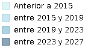

# Cobertura de red de agua corriente

Capa de cobertura del servicio sanitario de red de agua corriente para la Ciudad de Pergamino.

| | |
|---|---|
| Identificador | `servicios-sanitarios/cobertura_agua` |
| Geometría | polígonos |
| Fuente | [Cobertura de red de agua corriente en GeoNode](https://geonode.pergamino.gob.ar/catalogue/#/dataset/108), capa WFS `geonode:cobertura_agua` |
| Licencia | [CC-BY-SA-4.0](https://creativecommons.org/licenses/by-sa/4.0/) |
| Actualización declarada por la fuente | cuando es necesario |

## Propósito

Según el registro de GeoNode:

> La cobertura del servicio es aproximada, se deberá consultar a la Dirección de Obras y Servicios Sanitarios en caso de dudas. Indica la disponibilidad de cobertura de la red en el territorio, lo que no implica conexión sin permisos a la misma.

## Calidad de los datos

Según el registro de GeoNode:

> Los datos son obtenidos directamente de su productora, la Dirección de Obras y Servicios Sanitarios.

## Esquema

| Columna | Tipo |
|---|---|
| `id` | int64 |
| `zona` | string |
| `sistema` | string |
| `area` | double |
| `fecha_actualizacion` | string |
| `observaciones` | string |
| `gestion` | string |
| `fuente` | string |
| `geometry` | binary |
| `bbox` | struct<xmin: double, ymin: double, xmax: double, ymax: double> |

La fuente no publica descripciones de columnas: GeoNode devuelve una descripción vacía para cada atributo. Por eso las columnas no tienen descripción en `table:columns`, salvo `geometry` y `bbox`, que agrega este catálogo.

## Acceso

```python
import duckdb

con = duckdb.connect()
con.sql("INSTALL spatial; LOAD spatial; INSTALL httpfs; LOAD httpfs;")
con.sql("SELECT * FROM read_parquet('https://data.source.coop/nlebovits/pergamino-ide/servicios-sanitarios/cobertura_agua/cobertura_agua.parquet') LIMIT 10").show()
```

Hay más consultas, todas probadas, en [AGENTS.md](./AGENTS.md).

## Visualización

Las teselas vectoriales están en `./cobertura_agua.pmtiles` (capa `cobertura_agua`). El estilo por defecto, `styles/default.json`, deriva del estilo SLD que publica GeoNode para esta capa.

Leyenda tal como la publica la fuente:



## Versiones

Cada extracción que cambia los datos es una versión nueva. La versión actual está en `./cobertura_agua.parquet`. Las anteriores son los activos `version-*` de `collection.json`, con el número de registros y la suma de verificación de cada una. Sus archivos no cambian.

## Procedencia

Productor: Municipalidad de Pergamino. Publicado por la Dirección de Sistemas de Información Georreferenciada (DSIG) de la Municipalidad de Pergamino en [GeoNode](https://geonode.pergamino.gob.ar/catalogue/#/dataset/108).

Atribución declarada en GeoNode: "Municipalidad de Pergamino".

Este catálogo es un espejo. Para el dato autoritativo, consultar la IDE de Pergamino.

## Licencia

CC-BY-SA-4.0. Es la licencia que declara la Municipalidad de Pergamino para su IDE:

> Los datos dispuestos en nuestra Infraestructura de Datos Espaciales estan licenciados mediante Creative Commons 4.0 BY-SA, lo cual permite utilizar, compartir y adaptar este material siempre que reconozca atribución y permita la misma licencia en sus derivados.

## Advertencia del publicador

> La información contenida en la IDE se encuentra en constante actualización por parte de las distintas áreas responsables de su generación, por lo tanto, podria contener diferencias e inconsistencias en relación al objeto o fenómeno representado, tanto espacial como temporalmente.
