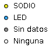

# Luminarias en vía pública

Luminarias en vía pública del Partido de Pergamino.

| | |
|---|---|
| Identificador | `vialidad/luminarias` |
| Geometría | puntos |
| Fuente | [Luminarias en vía pública en GeoNode](https://geonode.pergamino.gob.ar/catalogue/#/dataset/199), capa WFS `geonode:luminarias` |
| Licencia | [CC-BY-SA-4.0](https://creativecommons.org/licenses/by-sa/4.0/) |
| Actualización declarada por la fuente | continua |

## Propósito

Según el registro de GeoNode:

> La publicación de luminarias permite distinguir las zonas donde se existe luminaria LED y de Sodio, así como también el tipo de soporte de poste.

## Calidad de los datos

Según el registro de GeoNode:

> Los datos fueron inicialmente relevados en el Censo de Arbolado Público en el año 2012/2013, luego se reubicaron las luminarias mediante imágenes aéreas. Los datos técnicos son continuamente aportados por la Subecretaría de Control de Gestión.

## Esquema

| Columna | Tipo |
|---|---|
| `geometry` | binary |
| `id` | int64 |
| `id_gps` | int64 |
| `id_bbdd` | int64 |
| `id_asociado` | int64 |
| `ele_gps` | double |
| `time_gps` | string |
| `name_gps` | int64 |
| `modulo_gps` | string |
| `planilla_gps` | int64 |
| `longitud` | double |
| `latitud` | double |
| `calle` | string |
| `altura_domicilio` | string |
| `altura_inicial` | int64 |
| `altura_final` | int64 |
| `barrio` | string |
| `observaciones` | string |
| `lado` | string |
| `tipo_vereda` | string |
| `arboles` | string |
| `observaciones_bbdd` | string |
| `soporte_luminaria` | string |
| `ancho_vereda` | double |
| `tipo_lampara` | string |
| `cantidad_lamparas` | decimal128(38, 0) |
| `potencia_lampara` | int64 |
| `detalle` | string |
| `fecha_actualizacion` | string |
| `actualizador` | string |
| `fuente` | string |
| `recambio_led` | string |
| `localidad` | string |
| `bbox` | struct<xmin: double, ymin: double, xmax: double, ymax: double> |

La fuente no publica descripciones de columnas: GeoNode devuelve una descripción vacía para cada atributo. Por eso las columnas no tienen descripción en `table:columns`, salvo `geometry` y `bbox`, que agrega este catálogo.

## Acceso

```python
import duckdb

con = duckdb.connect()
con.sql("INSTALL spatial; LOAD spatial; INSTALL httpfs; LOAD httpfs;")
con.sql("SELECT * FROM read_parquet('https://data.source.coop/nlebovits/pergamino-ide/vialidad/luminarias/luminarias.parquet') LIMIT 10").show()
```

Hay más consultas, todas probadas, en [AGENTS.md](./AGENTS.md).

## Visualización

Las teselas vectoriales están en `./luminarias.pmtiles` (capa `luminarias`). El estilo por defecto, `styles/default.json`, deriva del estilo SLD que publica GeoNode para esta capa.

Leyenda tal como la publica la fuente:



## Versiones

Cada extracción que cambia los datos es una versión nueva. La versión actual está en `./luminarias.parquet`. Las anteriores son los activos `version-*` de `collection.json`, con el número de registros y la suma de verificación de cada una. Sus archivos no cambian.

La primera versión proviene del GeoServer anterior de la IDE Pergamino y sigue publicada en `./publico_luminarias.parquet`.

## Procedencia

Productor: Municipalidad de Pergamino. Publicado por la Dirección de Sistemas de Información Georreferenciada (DSIG) de la Municipalidad de Pergamino en [GeoNode](https://geonode.pergamino.gob.ar/catalogue/#/dataset/199).

Atribución declarada en GeoNode: "Municipalidad de Pergamino".

Este catálogo es un espejo. Para el dato autoritativo, consultar la IDE de Pergamino.

## Licencia

CC-BY-SA-4.0. Es la licencia que declara la Municipalidad de Pergamino para su IDE:

> Los datos dispuestos en nuestra Infraestructura de Datos Espaciales estan licenciados mediante Creative Commons 4.0 BY-SA, lo cual permite utilizar, compartir y adaptar este material siempre que reconozca atribución y permita la misma licencia en sus derivados.

## Advertencia del publicador

> La información contenida en la IDE se encuentra en constante actualización por parte de las distintas áreas responsables de su generación, por lo tanto, podria contener diferencias e inconsistencias en relación al objeto o fenómeno representado, tanto espacial como temporalmente.
