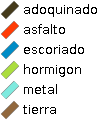

# Material de calzada

Describe el tipo de material mayoritario para las calles del Partido de Pergamino: adoquinado, asfalto, hormigón, escoriado, tierra y metálico.

| | |
|---|---|
| Identificador | `vialidad/material_de_calzada` |
| Geometría | líneas |
| Fuente | [Material de calzada en GeoNode](https://geonode.pergamino.gob.ar/catalogue/#/dataset/293), capa WFS `geonode:vista_callejero_1` |
| Licencia | [CC-BY-SA-4.0](https://creativecommons.org/licenses/by-sa/4.0/) |
| Actualización declarada por la fuente | continua |

## Propósito

Según el registro de GeoNode:

> El dataset ofrece el dato de tipo de cobertura de los ejes de calle.

## Calidad de los datos

Según el registro de GeoNode:

> Los datos son relevados por la Dirección de Infraestructura, Desarrollo Urbano.

## Esquema

| Columna | Tipo |
|---|---|
| `id` | int64 |
| `codigo` | int64 |
| `ancho` | int64 |
| `nombre` | string |
| `nombre_alt` | string |
| `pre_tipo` | string |
| `pre_dir` | string |
| `impar_ini` | int64 |
| `impar_fin` | int64 |
| `par_ini` | int64 |
| `par_fin` | int64 |
| `ruta` | string |
| `clase` | string |
| `sentido` | int64 |
| `barrio` | string |
| `barrido` | decimal128(38, 0) |
| `zona_barri` | string |
| `etiqueta` | string |
| `buffer` | int64 |
| `t_etiq` | int64 |
| `e_num_imp` | string |
| `e_num_par` | string |
| `localidad` | string |
| `long` | int64 |
| `long_km` | double |
| `buff` | int64 |
| `ordenanza` | string |
| `prog_ini` | double |
| `prog_fin` | double |
| `est_medido` | string |
| `cc_empresa` | string |
| `cc_fecha_inicio_obra` | string |
| `cc_fecha_fin_obra` | string |
| `cc_expediente` | string |
| `cc_etapa` | double |
| `pav_empresa` | string |
| `pav_fecha_inicio_obra` | string |
| `pav_fecha_fin_obra` | string |
| `pav_expediente` | string |
| `pav_etapa` | double |
| `velocidad_maxima` | int64 |
| `cpa_impar` | string |
| `cpa_par` | string |
| `restriccion_estacionamiento` | string |
| `observaciones` | string |
| `nombre_corto` | string |
| `ancho_vereda_par` | double |
| `ancho_vereda_impar` | double |
| `tipo_vereda_par` | string |
| `tipo_vereda_impar` | string |
| `cob_cloacas_par` | string |
| `cob_cloacas_impar` | string |
| `cob_agua_par` | string |
| `cob_agua_impar` | string |
| `ancho_nominal` | int64 |
| `ancho_real` | double |
| `ancho_calzada` | double |
| `id_calle` | int64 |
| `lado_ciclovia` | string |
| `transitable` | string |
| `numero_reparto_facturacion` | int64 |
| `nombre_completo` | string |
| `material_calzada` | string |
| `cordon_cuneta` | string |
| `proyecto_infraestructura` | string |
| `arbolado` | string |
| `geometry` | binary |
| `bbox` | struct<xmin: double, ymin: double, xmax: double, ymax: double> |

La fuente no publica descripciones de columnas: GeoNode devuelve una descripción vacía para cada atributo. Por eso las columnas no tienen descripción en `table:columns`, salvo `geometry` y `bbox`, que agrega este catálogo.

## Acceso

```python
import duckdb

con = duckdb.connect()
con.sql("INSTALL spatial; LOAD spatial; INSTALL httpfs; LOAD httpfs;")
con.sql("SELECT * FROM read_parquet('https://data.source.coop/nlebovits/pergamino-ide/vialidad/material_de_calzada/material_de_calzada.parquet') LIMIT 10").show()
```

Hay más consultas, todas probadas, en [AGENTS.md](./AGENTS.md).

## Visualización

Las teselas vectoriales están en `./material_de_calzada.pmtiles` (capa `material_de_calzada`). El estilo por defecto, `styles/default.json`, deriva del estilo SLD que publica GeoNode para esta capa.

Leyenda tal como la publica la fuente:



## Versiones

Cada extracción que cambia los datos es una versión nueva. La versión actual está en `./material_de_calzada.parquet`. Las anteriores son los activos `version-*` de `collection.json`, con el número de registros y la suma de verificación de cada una. Sus archivos no cambian.

La primera versión proviene del GeoServer anterior de la IDE Pergamino y sigue publicada en `./publico_material_de_calzada.parquet`.

## Procedencia

Productor: Municipalidad de Pergamino. Publicado por la Dirección de Sistemas de Información Georreferenciada (DSIG) de la Municipalidad de Pergamino en [GeoNode](https://geonode.pergamino.gob.ar/catalogue/#/dataset/293).

Atribución declarada en GeoNode: "Municipalidad de Pergamino".

Este catálogo es un espejo. Para el dato autoritativo, consultar la IDE de Pergamino.

## Licencia

CC-BY-SA-4.0. Es la licencia que declara la Municipalidad de Pergamino para su IDE:

> Los datos dispuestos en nuestra Infraestructura de Datos Espaciales estan licenciados mediante Creative Commons 4.0 BY-SA, lo cual permite utilizar, compartir y adaptar este material siempre que reconozca atribución y permita la misma licencia en sus derivados.

## Advertencia del publicador

> La información contenida en la IDE se encuentra en constante actualización por parte de las distintas áreas responsables de su generación, por lo tanto, podria contener diferencias e inconsistencias en relación al objeto o fenómeno representado, tanto espacial como temporalmente.
