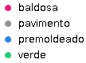

# Rampas de acceso discapacidad motriz

Rampas de acceso a veredas para personas con dificultades motrices o carritos de bebés/infantes para todo el Partido de Pergamino.

| | |
|---|---|
| Identificador | `vialidad/rampas_acceso_veredas` |
| Geometría | puntos |
| Fuente | [Rampas de acceso discapacidad motriz en GeoNode](https://geonode.pergamino.gob.ar/catalogue/#/dataset/241), capa WFS `geonode:rampas_acceso_discapacidad` |
| Licencia | [CC-BY-SA-4.0](https://creativecommons.org/licenses/by-sa/4.0/) |
| Actualización declarada por la fuente | cuando es necesario |

## Propósito

Según el registro de GeoNode:

> Las rampas de acceso son desniveles realizados en el cordón y vereda, generalmente en esquinas con el objeto de simplificar la accesibilidad en mobilidad a Personas con Discapacidad motriz.

## Calidad de los datos

Según el registro de GeoNode:

> El dato fue aportado por el Consejo de Personas con Discapacidad del Municipio, la Secretaría de Desarrollo Urbano y ampliado con imágenes aéreas.

## Esquema

| Columna | Tipo |
|---|---|
| `geometry` | binary |
| `id` | int64 |
| `direccion` | string |
| `estado` | string |
| `organismo` | string |
| `año` | int64 |
| `baranda` | string |
| `tipo` | string |
| `observaciones` | string |
| `barrio` | string |
| `localidad` | string |
| `bbox` | struct<xmin: double, ymin: double, xmax: double, ymax: double> |

La fuente no publica descripciones de columnas: GeoNode devuelve una descripción vacía para cada atributo. Por eso las columnas no tienen descripción en `table:columns`, salvo `geometry` y `bbox`, que agrega este catálogo.

## Acceso

```python
import duckdb

con = duckdb.connect()
con.sql("INSTALL spatial; LOAD spatial; INSTALL httpfs; LOAD httpfs;")
con.sql("SELECT * FROM read_parquet('https://data.source.coop/nlebovits/pergamino-ide/vialidad/rampas_acceso_veredas/rampas_acceso_veredas.parquet') LIMIT 10").show()
```

Hay más consultas, todas probadas, en [AGENTS.md](./AGENTS.md).

## Visualización

Las teselas vectoriales están en `./rampas_acceso_veredas.pmtiles` (capa `rampas_acceso_veredas`). El estilo por defecto, `styles/default.json`, deriva del estilo SLD que publica GeoNode para esta capa.

Leyenda tal como la publica la fuente:



## Versiones

Cada extracción que cambia los datos es una versión nueva. La versión actual está en `./rampas_acceso_veredas.parquet`. Las anteriores son los activos `version-*` de `collection.json`, con el número de registros y la suma de verificación de cada una. Sus archivos no cambian.

La primera versión proviene del GeoServer anterior de la IDE Pergamino y sigue publicada en `./publico_rampas_acceso_veredas.parquet`.

## Procedencia

Productor: Municipalidad de Pergamino. Publicado por la Dirección de Sistemas de Información Georreferenciada (DSIG) de la Municipalidad de Pergamino en [GeoNode](https://geonode.pergamino.gob.ar/catalogue/#/dataset/241).

Atribución declarada en GeoNode: "Municipalidad de Pergamino".

Este catálogo es un espejo. Para el dato autoritativo, consultar la IDE de Pergamino.

## Licencia

CC-BY-SA-4.0. Es la licencia que declara la Municipalidad de Pergamino para su IDE:

> Los datos dispuestos en nuestra Infraestructura de Datos Espaciales estan licenciados mediante Creative Commons 4.0 BY-SA, lo cual permite utilizar, compartir y adaptar este material siempre que reconozca atribución y permita la misma licencia en sus derivados.

## Advertencia del publicador

> La información contenida en la IDE se encuentra en constante actualización por parte de las distintas áreas responsables de su generación, por lo tanto, podria contener diferencias e inconsistencias en relación al objeto o fenómeno representado, tanto espacial como temporalmente.
